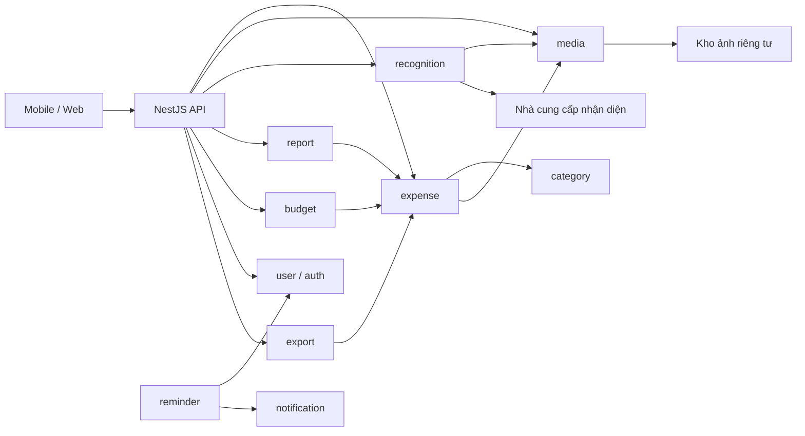
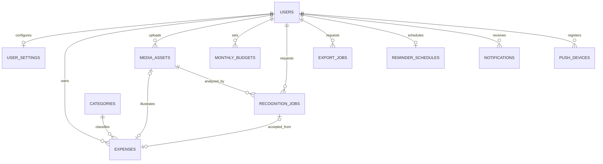
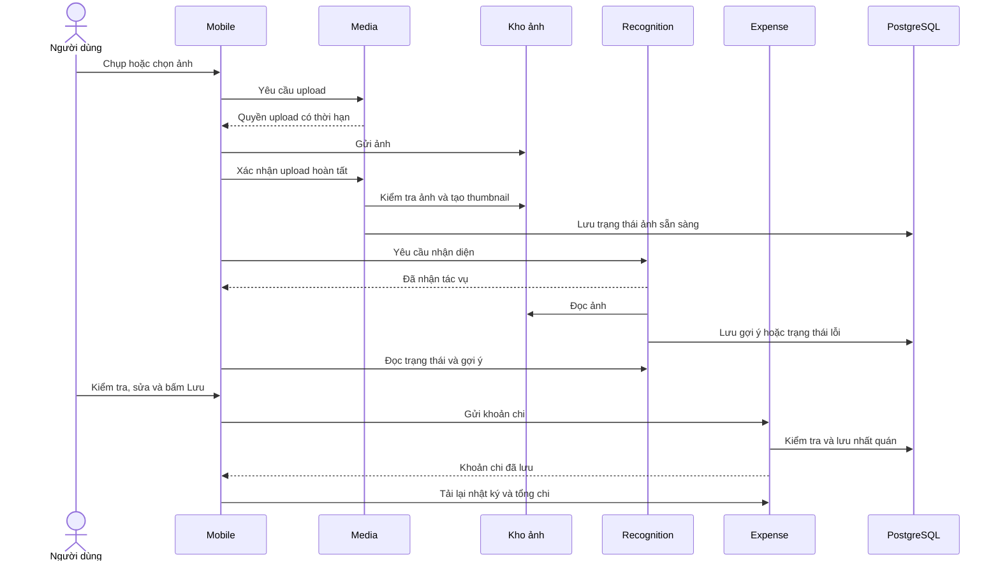
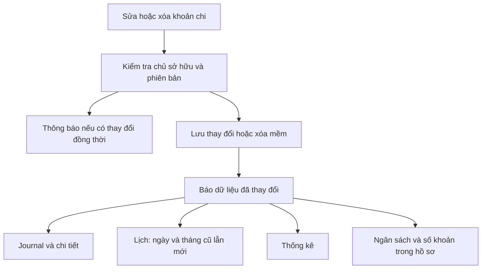

# Billet — Thiết kế tổng quát backend

Trạng thái: **Đã triển khai backend MVP** · Linear: [DEV-19](https://linear.app/devtvn/issue/DEV-19).

Thiết kế dựa trên [Billet — iOS UI](https://www.figma.com/design/80rXESXakYSS23nyN8NcT7/Billet?node-id=8-102) và nền tảng backend hiện có. Tài liệu tập trung vào mô hình dữ liệu, trách nhiệm module và cách dữ liệu di chuyển; khai báo schema và hợp đồng API chi tiết được chốt khi triển khai.

## 1. Hướng thiết kế

Billet là nhật ký chi tiêu bằng hình ảnh. Đơn vị nghiệp vụ trung tâm là **expense**: một khoản chi có thể có ảnh và caption. Journal, Calendar, Statistics và ngân sách đều đọc cùng nguồn dữ liệu đó.

Đề xuất dùng **NestJS modular monolith + PostgreSQL + private object storage**. Xử lý ảnh, nhận diện hóa đơn và xuất dữ liệu chạy bất đồng bộ qua tác vụ bền vững trong PostgreSQL ở giai đoạn đầu. Chưa cần tách microservice, thêm Redis hoặc xây bảng tổng hợp riêng.

Các quyết định chính:

- Lưu khoản chi không phụ thuộc OCR/AI thành công. Nhập tay và ảnh không đọc được vẫn là luồng hợp lệ.
- Ảnh nằm trong S3; PostgreSQL lưu thông tin file, quan hệ và dữ liệu chi tiêu.
- Kết quả nhận diện là gợi ý có nguồn gốc, không âm thầm ghi đè thông tin người dùng đã sửa.
- Tổng tiền, số khoản, mức ngân sách đã dùng và nhận xét được tính từ khoản chi còn hiệu lực.
- Dữ liệu người dùng tách biệt theo chủ sở hữu, kể cả ảnh và file xuất.
- Những module và luồng mới trong tài liệu là đề xuất, chưa phải tính năng đã chạy.

Phạm vi ban đầu chưa gồm bạn bè/feed chung, chia bill, ví, tài khoản ngân hàng, thu nhập, giao dịch định kỳ, chi tiết từng món hoặc quy đổi tỷ giá.

## 2. Nền tảng hiện có

| Thành phần         | Hiện trạng                                                        | Hướng sử dụng                                                      |
| ------------------ | ----------------------------------------------------------------- | ------------------------------------------------------------------ |
| NestJS API         | Đã có validation, xử lý lỗi, OpenAPI, logging                     | Giữ API boundary và convention hiện tại                            |
| Database           | PostgreSQL, TypeORM, migration, quy ước tên thống nhất            | Mở rộng bằng migration; không tự đồng bộ schema production         |
| user               | Hồ sơ, username, email/phone, trạng thái xác minh, xóa mềm        | Bổ sung tùy chọn cá nhân                                           |
| auth               | Đăng ký/đăng nhập, OTP, khôi phục mật khẩu, MFA                   | Tái sử dụng identity và bảo vệ tài nguyên cá nhân                  |
| notification       | Thông báo trong app, thiết bị nhận push, FCM                      | Dùng cho nhắc ghi chép; cần bổ sung lập lịch và gửi bền vững       |
| realtime           | WebSocket xác thực, gửi sự kiện theo người dùng trong một process | Báo thay đổi sau khi lưu; ứng dụng đọc lại dữ liệu khi kết nối lại |
| email, sms, health | Giao tiếp bên ngoài và kiểm tra sức khỏe dịch vụ                  | Giữ trách nhiệm hiện tại                                           |

Các nghiệp vụ expense, category, media, recognition, report, budget, reminder và export đã được bổ sung. Tham khảo [server README](../apps/server/README.md), OpenAPI và [realtime README](../apps/server/src/modules/realtime/README.md) cho hợp đồng đang chạy.

## 3. Phân chia module

| Module       | Dữ liệu và trách nhiệm sở hữu                                       | Phối hợp chính                                                     |
| ------------ | ------------------------------------------------------------------- | ------------------------------------------------------------------ |
| user         | Hồ sơ, tiền tệ mặc định, múi giờ, giao diện, tùy chọn nhắc          | Cung cấp thông tin người dùng và tùy chọn                          |
| auth         | Danh tính, xác thực, xác minh và bảo vệ truy cập                    | Dùng chung cho mọi tài nguyên cá nhân                              |
| expense      | Khoản chi, tính hợp lệ, chỉnh sửa/xóa, truy vấn nhật ký và tổng hợp | Kiểm tra danh mục/ảnh; cung cấp dữ liệu cho report, budget, export |
| category     | Danh mục, tên, màu, thứ tự và trạng thái sử dụng                    | Cung cấp danh mục ổn định cho expense                              |
| media        | Upload, xác minh ảnh, thumbnail, quyền xem và vòng đời file         | Làm việc với kho lưu trữ; không xử lý nghiệp vụ tiền               |
| recognition  | Đọc hóa đơn, chuẩn hóa gợi ý, độ tin cậy và trạng thái xử lý        | Đọc ảnh qua media, gọi nhà cung cấp nhận diện                      |
| report       | Biểu đồ, so sánh kỳ và nhận xét chi tiêu                            | Đọc dữ liệu tổng hợp từ expense                                    |
| budget       | Hạn mức theo tháng và loại tiền                                     | Đối chiếu chi tiêu thực tế từ expense                              |
| reminder     | Lịch nhắc, lần chạy tiếp theo và tránh gửi lặp                      | Đọc tùy chọn user, gửi qua notification                            |
| notification | Hộp thư, trạng thái đã đọc, thiết bị và gửi push                    | Tái sử dụng nền tảng hiện có                                       |
| export       | Yêu cầu xuất, dữ liệu tại thời điểm xuất, file kết quả              | Đọc qua expense, lưu file riêng tư                                 |
| realtime     | Thông báo dữ liệu đã thay đổi                                       | Gửi tín hiệu để ứng dụng tải lại thông tin                         |

### Ranh giới và phụ thuộc

Mỗi module sở hữu dữ liệu và logic của mình. Module khác sử dụng chức năng công khai, không truy cập trực tiếp entity hoặc repository nội bộ. Các phép tổng hợp chi tiêu nằm trong expense; report và budget không tải toàn bộ lịch sử vào bộ nhớ để tự tính.

Journal, Calendar và Profile là cách trình bày dữ liệu của expense/user/budget, chưa cần module riêng. Chỉ tách khi xuất hiện nghiệp vụ độc lập.

Code tiếp tục nằm trong các feature của server theo quy ước repository. Module nhỏ giữ cấu trúc gọn; module có nhiều trách nhiệm cùng vai trò mới chia thư mục. Phần dùng chung chỉ chứa hạ tầng và primitive, không chuyển logic nghiệp vụ ra ngoài feature. Chưa thêm package chia sẻ cho tới khi ít nhất hai app cần cùng hợp đồng ổn định.

## 4. Database đề xuất

### 4.1. Quy ước dữ liệu

**Định danh và vòng đời.** Giữ quy ước ID bigint của repository, biểu diễn bằng chuỗi ở API để không mất độ chính xác. Mỗi bản ghi có thời điểm tạo/cập nhật; khoản chi và tài nguyên hỗ trợ xóa bởi người dùng dùng xóa mềm.

**Tiền.** Lưu số tiền theo đơn vị nhỏ nhất của loại tiền và tính toán chính xác. Ví dụ 58.000 VND được lưu là 58.000 đồng; 58 USD tương ứng 5.800 cent. Không dùng số thực cho phép tính tài chính, không cộng trực tiếp các loại tiền khác nhau.

**Thời gian.** Phân biệt thời điểm chi tiền với lúc server ghi nhận. Lưu thời điểm chuẩn và múi giờ gốc; nhóm ngày/tháng theo múi giờ tài khoản thống nhất. Đổi múi giờ có thể làm khoản chi chuyển ngày trong báo cáo nên cần tải lại các phần tổng hợp.

**Chủ sở hữu.** Khoản chi, ảnh, kết quả nhận diện và file xuất phải thuộc đúng người dùng. Việc tham chiếu được một bản ghi không đồng nghĩa có quyền sử dụng bản ghi đó.

### 4.2. Quan hệ dữ liệu

Sơ đồ giữ tên các nhóm bảng để trao đổi thiết kế, lược bỏ khai báo cột và kiểu dữ liệu.

Giai đoạn đầu, một khoản chi có tối đa một ảnh và một kết quả nhận diện được chấp nhận. Nhập tay có thể không có cả hai. Một ảnh có thể được nhận diện lại nhiều lần nhưng không tự tạo nhiều khoản chi.

### 4.3. Nội dung các nhóm bảng

| Nhóm bảng                   | Nội dung chính                                                                                         | Quy tắc quan trọng                                                                                  |
| --------------------------- | ------------------------------------------------------------------------------------------------------ | --------------------------------------------------------------------------------------------------- |
| users                       | Hồ sơ và thông tin tài khoản hiện có                                                                   | Không đưa thông tin xác thực vào dữ liệu chi tiêu hoặc file xuất                                    |
| user_settings               | Múi giờ, tiền tệ mặc định, ngôn ngữ, giao diện, giờ nhắc                                               | Mỗi người dùng một bộ tùy chọn; thay đổi tiền tệ mặc định không đổi lịch sử                         |
| expenses                    | Chủ sở hữu, số tiền/loại tiền, thời gian, caption, danh mục, cửa hàng, địa điểm, ảnh và nguồn ghi nhận | Số tiền hợp lệ; danh mục mặc định khi chưa phân loại; ghi nhận phiên bản để phát hiện sửa đồng thời |
| categories                  | Mã ổn định, tên, màu, biểu tượng, thứ tự và trạng thái                                                 | Bắt đầu bằng danh mục hệ thống; ngừng sử dụng thay vì xóa danh mục đang có khoản chi                |
| media_assets                | Chủ sở hữu, vị trí file/thumbnail, định dạng, kích thước và trạng thái xử lý                           | File riêng tư; xác minh trước khi gắn vào khoản chi; ảnh bỏ dở được dọn                             |
| recognition_jobs            | Ảnh nguồn, nhà cung cấp, trạng thái, gợi ý từng trường, độ tin cậy và thông tin thử lại                | Kết quả chưa xác nhận không phải dữ liệu chi tiêu chính thức                                        |
| monthly_budgets             | Người dùng, tháng, loại tiền và hạn mức                                                                | Một ngân sách đang hiệu lực cho mỗi tháng/loại tiền; không lưu riêng mức đã chi                     |
| reminder_schedules          | Lần chạy tiếp theo và lần đã nhắc gần nhất                                                             | Lịch được tính từ tùy chọn user; cập nhật khi đổi giờ, múi giờ hoặc tắt nhắc                        |
| notifications, push_devices | Nội dung/thời điểm thông báo, trạng thái đọc/gửi và thiết bị                                           | Tái sử dụng bảng hiện có; bổ sung chống trùng và xử lý gửi lại                                      |
| export_jobs                 | Người yêu cầu, phạm vi xuất, thời điểm dữ liệu, trạng thái, file kết quả và hạn tải                    | Chỉ chủ sở hữu được tải; không trả file chưa hoàn tất                                               |

Không cần bảng riêng cho nhật ký, ô lịch, số liệu thống kê hay ngân sách đã dùng. Cửa hàng và địa điểm ban đầu là thông tin trên khoản chi; chỉ chuẩn hóa thành danh bạ khi có nhu cầu tái sử dụng hoặc quản trị rõ ràng.

Ghi lại nguồn của thông tin: do người dùng nhập, do thiết bị cung cấp, giá trị mặc định hay gợi ý nhận diện. Nguồn này giúp giải thích kết quả và tránh ghi đè chỉnh sửa.

### 4.4. Toàn vẹn và truy vấn

- Liên kết khoản chi–ảnh–nhận diện phải cùng chủ sở hữu. Ảnh phải xử lý xong và còn quyền sử dụng.
- Một yêu cầu lưu được gửi lại phải trả về cùng khoản chi. Cùng mã yêu cầu nhưng nội dung khác cần báo xung đột.
- Giữ dấu nhận biết yêu cầu kể cả khi khoản chi đã xóa mềm, tránh retry làm dữ liệu xuất hiện lại.
- Tránh gắn cùng một ảnh vào nhiều khoản chi ở MVP.
- Tối ưu truy vấn theo người dùng, thời gian và loại tiền; danh sách sắp xếp ổn định và có phân trang.
- Tổng ngày/tháng không phụ thuộc số mục đã tải trong một trang danh sách.
- Summary, số khoản và phân bổ danh mục trong cùng response phải đọc từ cùng thời điểm dữ liệu.
- Worker cần tìm nhanh tác vụ đến hạn, tác vụ đang xử lý quá lâu và file bỏ dở.
- Ràng buộc liên kết trong database không tự xử lý xóa mềm; logic nghiệp vụ vẫn phải kiểm tra trạng thái còn hiệu lực.

## 5. Data flow

### 5.1. Chụp hoặc chọn ảnh → gợi ý → lưu

1. Client giữ preview và bản nháp cục bộ. Upload ảnh và nhận diện không khóa thao tác nhập tiền/caption.
2. Media xác minh ảnh và tạo thumbnail trước khi cho phép gắn vào khoản chi. Nếu còn xử lý, client thể hiện trạng thái chờ.
3. Recognition chạy nền, có giới hạn thời gian và số lần thử. Gợi ý chỉ điền vào thông tin còn trống hoặc chưa được người dùng sửa.
4. Khi bấm lưu, expense kiểm tra quyền sở hữu, ảnh, danh mục, tiền và thời gian; lưu cùng thông tin chống tạo trùng.
5. Sau khi lưu thành công, ứng dụng cập nhật nhật ký và tải lại số liệu liên quan.
6. Chụp lại thay ảnh nháp và bỏ gợi ý cũ. Upload hoặc nhận diện hoàn tất không tự tạo expense.

**OCR chậm hoặc thất bại:** người dùng vẫn nhập tay và lưu. Đề xuất yêu cầu có số tiền hợp lệ; chưa biết tiền thì không dùng số không để thay thế. Nếu muốn lưu ảnh-only cần bổ sung trạng thái nháp và quy tắc loại khỏi tổng chi.

**Kết quả đến muộn:** khoản chi đã lưu không tự thay đổi. Người dùng có thể chấp nhận gợi ý qua lần chỉnh sửa tiếp theo.

**Nhập tay:** dùng cùng nghiệp vụ expense, bỏ qua media/recognition. Caption, cửa hàng và địa điểm có thể để trống; chưa chọn danh mục thì dùng “Khác”.

**Mất mạng:** giữ draft, ảnh và dấu nhận biết yêu cầu trên thiết bị; thể hiện “chưa đồng bộ”. Chỉ đánh dấu đã lưu server khi nhận được kết quả thành công. Chưa thiết kế đồng bộ chỉnh sửa offline hai chiều.

### 5.2. Sửa/xóa → cập nhật các phần tổng hợp

Khi sửa, phân biệt thông tin không thay đổi với thông tin người dùng chủ động xóa. Nếu có người dùng hoặc thiết bị khác sửa trước, báo xung đột để tải bản mới, không âm thầm ghi đè.

Đổi ngày hoặc loại tiền phải cập nhật cả phần tổng hợp cũ và mới. Giai đoạn đầu có thể tải lại toàn bộ nhóm dữ liệu liên quan để đơn giản.

Xóa dùng cơ chế xóa mềm. Gửi lại yêu cầu xóa không gây lỗi nghiệp vụ; gửi lại yêu cầu tạo cũ không làm hồi sinh khoản chi đã xóa. Khôi phục dữ liệu chưa thuộc phạm vi ban đầu.

Realtime chỉ phát sau khi dữ liệu đã lưu. Nếu mất sự kiện hoặc kết nối, client đọc lại qua API; không coi sự kiện realtime là bản dữ liệu chính thức.

### 5.3. Journal, Calendar, Statistics và Budget

Mọi phần tổng hợp dùng cùng chủ sở hữu, loại tiền, múi giờ và quy tắc loại khoản chi đã xóa.

| Phần dữ liệu | Cách xử lý                                                                                        |
| ------------ | ------------------------------------------------------------------------------------------------- |
| Journal      | Danh sách theo thời gian giảm dần, phân trang; tổng ngày tính trên toàn bộ khoản chi của ngày     |
| Calendar     | Tổng tháng, số khoản và tổng mỗi ngày, một số thumbnail đại diện; chọn ngày mở danh sách chi tiết |
| Statistics   | Tổng kỳ, chuỗi thời gian, tỷ trọng danh mục, so sánh kỳ và nhận xét                               |
| Budget       | Hạn mức tháng trừ tổng chi thực tế cùng loại tiền; không lưu bản sao tổng chi                     |
| Profile      | Đếm khoản chi đang hiệu lực trong toàn bộ lịch sử, gồm nhập tay                                   |

Tuần bắt đầu thứ Hai. Tuần/tháng dùng dữ liệu theo ngày, năm dùng dữ liệu theo tháng; khoảng không có chi tiêu được điền bằng không. Lịch chỉ lưu dữ liệu ngày thực tế, không lưu các ô bố cục giao diện.

Kỳ đang diễn ra so với cùng phần thời gian đã trôi qua của kỳ trước; kỳ đã kết thúc so toàn kỳ. Khi tháng trước ngắn hơn, giới hạn ở ngày cuối tháng và trả rõ khoảng so sánh.

Phần trăm thay đổi tính từ chênh lệch với kỳ trước. Nếu kỳ trước chưa có chi tiêu, trả trạng thái chưa có cơ sở so sánh. Tỷ trọng danh mục tính từ tổng tiền; kỳ không có dữ liệu không tạo biểu đồ tỷ trọng giả.

Ngân sách còn lại có thể âm khi vượt hạn mức. Chưa đặt ngân sách được biểu diễn riêng, không dùng hạn mức bằng không. Chưa tự chuyển số dư hoặc lặp ngân sách tháng trước.

Nhận xét ban đầu dùng quy tắc có thể kiểm chứng, như ngày hoặc khung giờ chi nhiều nhất. Cần đủ dữ liệu mới nhận xét thói quen. “Bữa trưa” chỉ là ước tính nếu dựa vào danh mục ăn uống và giờ chi; không suy ra từ mọi khoản chi giữa trưa. Các phép tính không cần LLM.

### 5.4. Tùy chọn → nhắc ghi chép

Người dùng bật nhắc và chọn giờ. Backend cập nhật tùy chọn và lịch tương ứng một cách nhất quán; lịch lấy giờ/múi giờ từ user làm nguồn chính.

Scheduler chọn lịch đến hạn, kiểm tra lại người dùng và tùy chọn rồi tạo thông báo. Một người dùng chỉ có một thông báo nhắc cho cùng ngày địa phương ở MVP. Tạo thông báo và cập nhật lịch kế tiếp cần được lưu cùng nhau để tránh mất hoặc lặp lịch khi dịch vụ dừng.

Việc gửi push xử lý từ thông báo đã lưu, có thử lại khi lỗi tạm thời. Token không còn hợp lệ được vô hiệu hóa. Có thể chống trùng trong hộp thư, nhưng không cam kết nhà cung cấp push giao đúng một lần; client cũng cần nhận biết thông báo trùng.

Đổi giờ, múi giờ hoặc tắt nhắc phải tính lại lịch. Tính theo ngày địa phương thay vì cộng cố định 24 giờ; xử lý giờ bị thiếu/lặp ở múi giờ có chuyển giờ mùa hè. Khi dịch vụ phục hồi, không dồn toàn bộ thông báo cũ cho người dùng.

Face ID chỉ khóa ứng dụng hoặc thông tin đăng nhập trên thiết bị; không lưu dữ liệu sinh trắc vào backend và không thay thế MFA phía server. Giao diện có thể đồng bộ qua tùy chọn; phiên bản app thuộc client.

### 5.5. Xuất dữ liệu

1. Người dùng chọn phạm vi và yêu cầu xuất; backend lưu tác vụ, trả trạng thái đang xử lý.
2. Worker đọc dữ liệu tại một thời điểm nhất quán, ghi nhận thời điểm đó và tạo file ở nền.
3. File hoàn tất được lưu riêng tư; người dùng nhận liên kết tải có thời hạn.
4. Backend kiểm tra lại quyền sở hữu và thời hạn khi cấp liên kết. File dở dang hoặc hết hạn không được tải.

MVP xuất CSV gồm thời gian, số tiền/loại tiền, caption, danh mục, cửa hàng và địa điểm; chưa bundle ảnh. Không xuất token, thông tin xác thực, nội dung OCR thô hoặc đường dẫn ảnh có quyền truy cập.

File CSV cần xử lý đúng ký tự đặc biệt và tránh nội dung text bị phần mềm bảng tính thực thi như công thức. Dữ liệu lớn cần đọc theo đợt, giới hạn phạm vi và thời gian xử lý. File lỗi hoặc bỏ dở được dọn riêng.

## 6. Ranh giới API

Giữ API trong server, dùng xác thực hiện có và hợp đồng dữ liệu tách khỏi entity database. Chi tiết route, payload và kiểu dữ liệu sẽ được khai báo trong OpenAPI khi triển khai.

| Nhóm chức năng    | Thông tin nhận                                    | Kết quả cung cấp                                 |
| ----------------- | ------------------------------------------------- | ------------------------------------------------ |
| Hồ sơ và tùy chọn | Các thay đổi cá nhân                              | Hồ sơ, tùy chọn và tổng số khoản                 |
| Danh mục          | Yêu cầu danh sách                                 | Danh mục đang sử dụng                            |
| Upload ảnh        | Thông tin file, xác nhận upload                   | Quyền upload có hạn, trạng thái ảnh và quyền xem |
| Nhận diện         | Ảnh đã xử lý xong                                 | Trạng thái, gợi ý và độ tin cậy                  |
| Khoản chi         | Nội dung ghi nhận/chỉnh sửa và phiên bản đang xem | Chi tiết đã lưu hoặc thông báo xung đột          |
| Nhật ký và lịch   | Khoảng thời gian, loại tiền, phân trang           | Danh sách, tổng tiền, nhóm ngày và thumbnail     |
| Báo cáo           | Kỳ và mốc thời gian                               | Tổng, khoảng so sánh, biểu đồ và nhận xét        |
| Ngân sách         | Tháng, loại tiền, hạn mức                         | Hạn mức, đã chi và còn lại                       |
| Xuất dữ liệu      | Phạm vi và định dạng                              | Trạng thái và liên kết tải khi hoàn tất          |

Không tin chủ sở hữu do client gửi. Thông tin trả ra không chứa khóa kho lưu trữ, bí mật hay phản hồi thô của nhà cung cấp. Phân biệt rõ dữ liệu không hợp lệ, chưa xác thực, không có quyền và xung đột cập nhật.

Sự kiện realtime chỉ chứa định danh và trạng thái cần thiết để client tải lại dữ liệu. Worker tách process không thể tự gửi tới socket của API hiện tại; giai đoạn đầu client hỏi trạng thái định kỳ, chỉ bổ sung broker/relay khi cần.

## 7. Xử lý nền, bảo mật và vận hành

### Tác vụ nền

Tác vụ có các giai đoạn chờ, đang xử lý, thành công, thất bại hoặc hủy. Worker nhận quyền xử lý có thời hạn; khi worker dừng, tác vụ được nhận lại. Kết quả từ worker đã mất quyền không được ghi đè kết quả mới.

I/O tới storage hoặc OCR không giữ transaction database dài. Lỗi tạm thời được thử lại với khoảng chờ tăng dần và giới hạn số lần; lỗi cuối cùng phải được lưu để client biết và có hướng xử lý.

Chưa cần một hệ thống hàng đợi riêng ở MVP. Theo dõi thời gian chờ, tỷ lệ thất bại và tải thực tế trước khi tách hạ tầng.

### Bảo vệ dữ liệu

- Kho ảnh riêng tư; quyền upload/download chỉ có hiệu lực ngắn hạn và đúng tài nguyên.
- Kiểm tra nội dung thực, kích thước và độ phân giải ảnh, không chỉ tin tên file hoặc định dạng client khai báo.
- Loại metadata nhạy cảm khỏi ảnh phục vụ giao diện. Địa điểm là tùy chọn, chỉ lưu tọa độ khi người dùng đồng ý.
- Caption và nội dung hóa đơn là dữ liệu không đáng tin; giới hạn nội dung và kiểm chứng kết quả nhận diện trước khi sử dụng.
- Không log ảnh, token, đường dẫn có quyền truy cập hoặc nội dung cá nhân đầy đủ. Log định danh tác vụ, trạng thái và thời gian xử lý.
- Credentials chỉ ở server, đọc từ môi trường và kiểm tra cấu hình lúc khởi động.

### Vòng đời và khả năng phục hồi

Đề xuất để review: ảnh upload bỏ dở và file xuất giữ 24 giờ; dữ liệu đã xóa mềm cùng ảnh liên quan giữ 30 ngày trước khi dọn; kết quả nhận diện chỉ giữ trong thời gian cần thiết. Đây chưa phải cam kết lưu trữ sản phẩm.

Cleanup phải kiểm tra file còn được khoản chi hoặc tác vụ đang chạy sử dụng hay không. Xóa bản ghi database không tự xóa object storage. Khi dọn kết quả nhận diện, giữ nguyên giá trị chi tiêu đã được người dùng chấp nhận.

Xóa tài khoản cần thu hồi truy cập, dừng tác vụ và dọn dữ liệu theo chính sách. Liên kết đã cấp có thể còn hoạt động tới khi hết hạn, nên cần thời hạn ngắn.

Database cần backup và kiểm chứng khả năng restore; storage có chính sách vòng đời phù hợp. Realtime hiện chỉ hoạt động trong một process, cần cơ chế chuyển sự kiện giữa instance trước khi mở rộng nhiều API instance.

Chưa cache hoặc lưu sẵn số liệu tổng hợp ở MVP. Khi có nhu cầu, phải xử lý việc sửa/xóa khoản chi và thay đổi múi giờ để cache không lệch dữ liệu.

## 8. Hướng triển khai và kiểm chứng

| Đợt                  | Kết quả                                                | Trọng tâm kiểm chứng                                                                 |
| -------------------- | ------------------------------------------------------ | ------------------------------------------------------------------------------------ |
| 1 — Lõi chi tiêu     | Danh mục, tùy chọn, expense, nhập tay, nhật ký và lịch | Quyền sở hữu, tính tiền, thời gian, phân trang, sửa/xóa và chống trùng               |
| 2 — Capture          | Upload, thumbnail, lưu ảnh và nhận diện                | Ảnh lỗi/chụp lại, OCR chậm/thất bại, kết quả muộn và retry                           |
| 3 — Tổng hợp         | Thống kê, ngân sách, nhận xét theo quy tắc             | Các phần tổng hợp khớp nhau, kỳ trước bằng không, vượt ngân sách, đổi ngày/loại tiền |
| 4 — Hồ sơ hoàn chỉnh | Nhắc ghi chép, xuất CSV, vòng đời dữ liệu              | Lịch đổi khi đang chạy, gửi lại, file nhất quán, quyền tải và hết hạn                |

Schema được bổ sung bằng migration theo phụ thuộc dữ liệu. Không sửa migration đã chia sẻ; thay đổi local chưa chia sẻ được gom theo kết quả cuối cùng. API dùng local private object storage trong development qua một provider có thể thay thế; production cần nối adapter S3-compatible. Recognition dùng provider vô hiệu hóa mặc định cho tới khi cấu hình nhà cung cấp OCR, vì vậy nhập tay vẫn hoạt động và tác vụ OCR trả trạng thái lỗi rõ ràng sau retry giới hạn.

Các tình huống cần kiểm chứng khi xây dựng:

- Người dùng không truy cập dữ liệu, ảnh hoặc file xuất của nhau.
- Gửi cùng yêu cầu nhiều lần không tạo trùng; retry sau khi xóa không hồi sinh khoản chi.
- Hai lần chỉnh sửa đồng thời được phát hiện; OCR muộn không ghi đè người dùng.
- Khoản chi gần nửa đêm, cuối tháng/năm và đổi múi giờ được nhóm đúng.
- Nhật ký, lịch, báo cáo và ngân sách khớp số liệu trước và sau sửa/xóa.
- Không cộng lẫn loại tiền; tổng lớn vẫn giữ độ chính xác.
- Worker dừng giữa chừng có thể phục hồi; cleanup không xóa ảnh vừa được sử dụng.
- Reminder không tạo lặp trong hộp thư; export nhất quán khi dữ liệu đang được chỉnh sửa.

Chạy các completion checks của repository khi triển khai; bổ sung kiểm thử tại ranh giới database, storage, OCR và API liên quan. Cập nhật cấu hình mẫu, README và OpenAPI cùng chức năng mới.

## 9. Các quyết định cần chốt

| Quyết định                 | Mặc định đề xuất                                                       | Nếu thay đổi                                                         |
| -------------------------- | ---------------------------------------------------------------------- | -------------------------------------------------------------------- |
| Lưu khi chưa biết tiền     | Cần số tiền hợp lệ, OCR không bắt buộc                                 | Cần trạng thái nháp và quy tắc loại khỏi tổng                        |
| Tự cập nhật từ OCR sau lưu | Người dùng xác nhận gợi ý                                              | Cần chính sách nguồn dữ liệu và xử lý xung đột từng trường           |
| Tiền tệ                    | MVP VND; dữ liệu từng khoản giữ loại tiền                              | Nhiều loại tiền cần tách tổng; quy đổi cần nguồn tỷ giá              |
| Danh mục                   | Danh mục phẳng; “bữa trưa” chỉ là ước tính nếu chưa có phân loại riêng | Phân cấp hoặc loại bữa ăn ảnh hưởng báo cáo                          |
| Ngày và kỳ so sánh         | Múi giờ tài khoản; kỳ hiện tại so cùng phần kỳ trước                   | Phải áp dụng đồng nhất mọi phần tổng hợp                             |
| Ngân sách                  | Một hạn mức mỗi tháng/loại tiền, đặt riêng từng tháng                  | Lặp ngân sách, chuyển số dư hoặc chia theo danh mục cần quy tắc thêm |
| Nhắc ghi chép              | Một lịch server theo múi giờ tài khoản                                 | Nhắc offline hoặc nhiều lịch cần tránh trùng giữa thiết bị/server    |
| Export và retention        | CSV chưa kèm ảnh; thời hạn lưu cần duyệt                               | Bundle ảnh, khôi phục hoặc xuất toàn tài khoản cần luồng bổ sung     |
| Địa điểm                   | Text tùy chọn; GPS khi có đồng ý                                       | Tìm địa điểm tự động cần tích hợp nhà cung cấp                       |

Các lựa chọn này được chốt theo từng đợt triển khai; không cần khóa chi tiết kỹ thuật trước khi review mô hình tổng quát.
