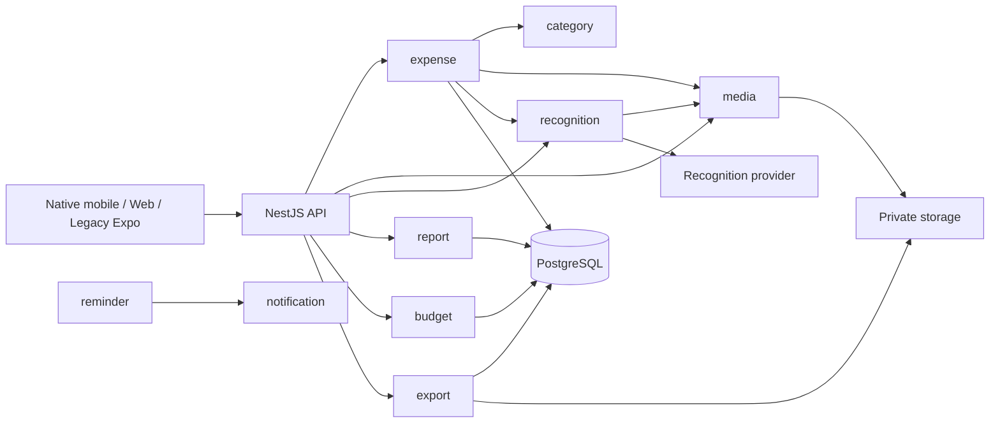

# Technical Design — Backend

| Thông tin  | Giá trị                                   |
| ---------- | ----------------------------------------- |
| Phạm vi    | NestJS API, PostgreSQL và private storage |
| Trạng thái | Hiện hành                                 |

## 1. Tổng quan

### Bối cảnh

Billet tổ chức dữ liệu quanh **expense**: một khoản chi có tiền, loại tiền, thời gian và ngữ cảnh tùy chọn như ảnh/caption. Nhật ký, lịch, báo cáo và ngân sách đọc các khoản còn hiệu lực. Nhập tay là luồng cốt lõi; nhận diện ảnh chỉ cung cấp gợi ý và không tự sửa khoản chi đã lưu.

Backend hiện là NestJS modular monolith + PostgreSQL + private object storage boundary. Development dùng local storage; kết nối S3-compatible production là bước tích hợp riêng, không phải điều kiện đã có. Chưa thêm Redis, microservice hoặc bảng tổng hợp riêng.

Tài liệu mô tả source hiện hành, không xác nhận deployment hoặc nghiệm thu sản phẩm. Route/DTO hiện hành nằm trong OpenAPI và [server README](../../apps/server/README.md). Các thiết kế [nhận diện](./04-expense-image-recognition.md) và [xử lý ảnh](./03-image-processing.md) là đề xuất mở rộng.

### Mục tiêu và phạm vi

Ghi lại boundary, invariant và giới hạn vận hành của backend để thay đổi expense, media, job và các tổng hợp không phá vỡ quyền sở hữu, tính nhất quán tiền tệ hoặc luồng nhập tay. Phạm vi gồm API, PostgreSQL, storage và worker chạy trong server; không thiết kế chi tiết UI mobile/web hoặc hạ tầng production chưa được tích hợp.

## 2. Thiết kế

### Kiến trúc

| Module                         | Trách nhiệm và hiện trạng                                                                                     |
| ------------------------------ | ------------------------------------------------------------------------------------------------------------- |
| `user`, `auth`                 | Danh tính, hồ sơ, tùy chọn; đăng nhập, refresh/logout, xác minh và khôi phục truy cập                         |
| `expense`                      | Create idempotency, sửa theo version, xóa mềm, danh sách, tổng hợp nhật ký và lịch                            |
| `category`                     | Danh mục hệ thống và cá nhân; chỉ chủ sở hữu sửa danh mục cá nhân; từ chối xóa danh mục đang dùng             |
| `media`                        | Reserve/upload/read ảnh riêng tư; kiểm byte length và signature JPEG/PNG/WebP; chưa tạo variants              |
| `recognition`                  | Job lưu PostgreSQL, vòng xử lý mỗi 5 giây; provider `disabled` hoặc `google-ai-studio`                        |
| `report`                       | Truy vấn tổng, chuỗi thời gian, phân bổ danh mục, kỳ so sánh và ngày chi cao nhất                             |
| `budget`                       | Hạn mức tháng/loại tiền; tính đã chi và còn lại từ expense                                                    |
| `reminder`                     | Đồng bộ lịch từ user settings, kiểm lịch mỗi phút, tạo notification có deduplication key theo ngày địa phương |
| `export`                       | Job CSV, lưu file riêng tư, kiểm chủ sở hữu và hạn tải                                                        |
| `notification`, `email`, `sms` | Hộp thư, push FCM và các adapter gửi thông tin theo cấu hình                                                  |
| `realtime`                     | WebSocket xác thực và publish theo người dùng trong một process                                               |

Hướng phụ thuộc là composition → feature → shared primitive. Feature sử dụng public boundary của feature khác; database entity không được đưa sang client. Report, budget và export hiện truy vấn trực tiếp bảng expense; thay đổi schema expense phải xét các consumer này, không giả định đã có aggregate API dùng chung. Journal, Calendar và Profile là cách trình bày, chưa cần module nghiệp vụ riêng.

### Luồng xử lý

#### Nhập tay hoặc lưu kèm ảnh

1. Client mở bản nháp; ảnh chụp/chọn được preview cục bộ với Retake và Use photo. Hủy không tạo expense hoặc gọi xử lý ảnh từ xa.
2. Người dùng nhập tiền và có thể thêm caption/danh mục. Luồng capture mục tiêu được mô tả trong [capture và hiển thị ảnh](./02-mobile-capture.md); Expo hiện upload trong thao tác lưu.
3. Nếu có ảnh, client reserve qua `POST /media`, rồi PUT raw bytes tới URL API trả về. Server kiểm chủ sở hữu, byte length và signature, ghi storage rồi đánh dấu `ready`. Không có bước client upload trực tiếp S3 hoặc xác nhận tạo thumbnail.
4. Client tạo expense với idempotency key. Server kiểm tiền, thời gian, danh mục và media `ready`; nhận diện thành công không phải điều kiện bắt buộc.
5. Sau response thành công, client cập nhật nhật ký và tải lại các tổng liên quan. Upload thành công chưa có nghĩa expense đã lưu.

Ảnh được phép tái sử dụng ở nhiều expense cùng chủ sở hữu. Không thêm ràng buộc độc quyền ảnh–expense. Lưu không ảnh phải là lựa chọn rõ ràng nếu upload lỗi; không âm thầm bỏ ảnh người dùng đã chấp nhận.

#### Nhận diện

Client có thể tạo/đọc `recognition-jobs` từ media ready. Server lưu job, provider, attempts, thời điểm chạy lại và lease; provider trả gợi ý hoặc lỗi. Expense có thể tham chiếu job thành công thuộc cùng người dùng và media phù hợp.

Đây là luồng job nền hiện hành. OCR on-device, Decision API đồng bộ, rule learning và structured provenance thuộc [thiết kế nhận diện](./04-expense-image-recognition.md), chưa có trong implementation hiện tại. Kết quả đến muộn không được tự cập nhật expense; thumbnail/display worker không nằm trên đường lưu hoặc inference.

#### Nhắc ghi chép và xuất dữ liệu

Reminder đọc user settings để tạo lịch, dùng deduplication key theo user/ngày cho notification. Push tùy cấu hình và quyền thiết bị; không cam kết nhà cung cấp giao đúng một lần. Đổi múi giờ/giờ nhắc phải tính lại lịch, tránh cộng cố định 24 giờ ở múi giờ có DST.

Export chạy nền, lọc owner/phạm vi/loại tiền và ghi CSV có escape chống công thức. File tải qua API xác thực và hết hạn sau 24 giờ. `snapshotAt` hiện là mốc worker chọn và dùng trong điều kiện `updated_at`, không phải lịch sử point-in-time có thể tái dựng mọi phiên bản cũ. Chưa bundle ảnh trong CSV.

### Quy tắc và trạng thái

- Expense update dùng optimistic `version`; dữ liệu cũ nhận xung đột thay vì ghi đè âm thầm. Xóa mềm loại khoản chi khỏi tổng. Create retry không được hồi sinh expense đã xóa.
- Khi thay ngày, loại tiền hoặc amount, client phải tải lại cả phạm vi cũ và mới bị ảnh hưởng. Tổng ngày/tháng phải tính đủ dữ liệu, độc lập phân trang.
- Mỗi loại tiền có tổng riêng; `amountMinor` và tổng tiền là chuỗi số nguyên ở API. Không dùng số thực để cộng tiền.
- Report so khoảng `[from,to)` với khoảng cùng độ dài ngay trước `from`; tỷ lệ thay đổi là `null` khi tổng kỳ trước bằng không.
- Budget hiện lọc tháng bằng biên ngày SQL, trong khi calendar/report có timezone đầu vào. Đồng nhất biên tháng theo múi giờ tài khoản và đọc mọi tổng từ cùng snapshot là yêu cầu cần kiểm chứng, chưa phải bảo đảm của mọi endpoint.

## 3. Contract và dữ liệu

### API / Event

REST dùng prefix `/api/v1` và xác thực hiện có; chủ sở hữu lấy từ session. DTO tách khỏi entity và không chứa private storage key hoặc raw provider output. Media content đi qua API có auth; không mô tả nó như signed S3 URL.

Realtime chỉ truyền tín hiệu/định danh đủ để tải lại dữ liệu. Transport hiện giữ socket trong một process; worker riêng hoặc nhiều API instance cần relay/broker trước khi publish xuyên process. Client phải đọc lại trạng thái sau reconnect. Xem [realtime contract](../../apps/server/src/modules/realtime/README.md).

### Dữ liệu

| Nhóm dữ liệu                  | Ràng buộc chính                                                                                                                                 |
| ----------------------------- | ----------------------------------------------------------------------------------------------------------------------------------------------- |
| `users`, `user_settings`      | Hồ sơ, timezone, currency và tùy chọn; không đưa bí mật xác thực vào expense/export                                                             |
| `expenses`                    | Owner, amount/currency, occurred time/timezone, category, media/job tùy chọn, caption/merchant/location, `fieldSources`, idempotency và version |
| `categories`                  | Danh mục hệ thống có owner null; danh mục cá nhân chỉ dùng trong tài khoản sở hữu                                                               |
| `media_assets`                | Private storage key, MIME, bytes, dimensions có thể null, trạng thái và expiry; `thumbnailKey` hiện chưa được dùng                              |
| `recognition_jobs`            | Owner/media, provider, status, suggestion, attempts, lịch retry và lease                                                                        |
| `monthly_budgets`             | Hạn mức theo user/tháng/currency; đã chi được truy vấn từ expense                                                                               |
| `reminder_schedules`          | Lịch tiếp theo và ngày địa phương đã nhắc                                                                                                       |
| `notifications`, push devices | Nội dung/trạng thái notification và thiết bị theo owner                                                                                         |
| `export_jobs`                 | Phạm vi, status, snapshot marker, private file key và hạn tải                                                                                   |

ID bigint được biểu diễn bằng chuỗi ở API. Tiền lưu minor units: 58.000 VND là `"58000"`, 58 USD là `"5800"`. Thời điểm chi tiền khác thời điểm tạo bản ghi; cùng một timezone phải được dùng khi đối soát các màn hình. Thay currency mặc định không đổi lịch sử.

Thay đổi schema dùng migration, không bật synchronize hoặc sửa migration đã chia sẻ. FK không thay thế kiểm tra quyền sở hữu, soft deletion và trạng thái tài nguyên.

## 4. Vận hành

- **Jobs:** recognition/export có trạng thái bền vững, retry hoặc lease recovery trong service; chưa coi đó là bằng chứng claim độc quyền an toàn khi nhiều worker chạy đồng thời. Row locking/claim token, bounded retries và bảo vệ stale writes cần kiểm chứng trước scale-out. Không giữ transaction dài lúc gọi provider/storage.
- **Ảnh:** hiện chỉ kiểm signature; JPEG/WebP chưa có dimensions đầy đủ. Decode validation, pixel limits, loại metadata và variants nằm trong [thiết kế xử lý ảnh](./03-image-processing.md). Không coi `thumbnailKey` hay `expiresAt` là bằng chứng các worker tương ứng đã chạy.
- **Riêng tư:** kiểm owner ở mọi boundary; không log ảnh, token, OCR thô hoặc URL chứa quyền truy cập. Provider credentials chỉ đọc từ môi trường và validate lúc startup.
- **Vòng đời:** cleanup cần kiểm tham chiếu từ mọi expense/job trước khi xóa source và variants. Thời hạn xóa dữ liệu phải được Product duyệt; giá trị expiry trên row không tự xóa file. Xóa tài khoản cần thu hồi truy cập, dừng job và dọn dữ liệu theo policy.
- **Phục hồi:** backup PostgreSQL và storage phải có bằng chứng restore. Theo dõi queue age, lỗi/retry, latency provider/storage và tài nguyên trước khi bổ sung hạ tầng.

## 5. Quyết định kỹ thuật

| Quyết định                             | Lý do và giới hạn                                                                            |
| -------------------------------------- | -------------------------------------------------------------------------------------------- |
| Modular monolith và PostgreSQL         | Giảm vận hành; scale nhiều worker vẫn cần claim và publish an toàn                           |
| Nhập tay không phụ thuộc AI            | Capture không bị chặn bởi provider; mọi gợi ý phải bảo vệ chỉnh sửa người dùng               |
| Private storage boundary               | Giữ kiểm quyền ở API; adapter production và vòng đời file cần tích hợp riêng                 |
| Tổng hợp từ expense còn hiệu lực       | Sửa/xóa phản ánh vào dữ liệu nguồn; cần đối soát timezone, snapshot và truy vấn khi tải tăng |
| Media tái sử dụng trong cùng tài khoản | Không upload lại ảnh đã có; cleanup phải kiểm mọi tham chiếu                                 |

## 6. Kiểm chứng và triển khai

### Kiểm chứng

Ưu tiên kiểm tra các boundary: truy cập chéo hai tài khoản; create retry và retry sau xóa; update đồng thời; upload sai bytes/signature; provider chậm/lỗi; khoản chi sát nửa đêm/cuối tháng; tổng trước/sau sửa/xóa; nhiều loại tiền; job crash/concurrency; export trong lúc sửa dữ liệu; reminder đổi giờ.

Tài liệu này đối chiếu source hiện hành nhưng không phải bằng chứng các kịch bản trên đã chạy. Mỗi thay đổi runtime phải ghi lại test ở boundary bị ảnh hưởng và kiểm tra contract OpenAPI tương ứng.

### Triển khai

Các thay đổi schema phải dùng migration additive khi cần duy trì client cũ, triển khai server tương thích trước client và chỉ xóa contract cũ sau khi không còn consumer. Thay đổi job/storage phải có đường rollback giữ được expense nhập tay và media source; không drop dữ liệu hoặc migration trong cùng bước tắt feature.

## 7. Vấn đề chưa chốt

| Vấn đề                        | Điều kiện giải quyết                                                                            |
| ----------------------------- | ----------------------------------------------------------------------------------------------- |
| Claim job khi scale-out       | Chứng minh row locking/claim token và stale-write protection bằng integration test nhiều worker |
| Snapshot giữa các tổng        | Chốt semantics và kiểm chứng report/budget/calendar trong lúc expense thay đổi                  |
| Timezone ngân sách            | Dùng cùng biên tháng theo timezone tài khoản và có test sát ranh giới tháng                     |
| Cleanup media                 | Có reference check qua mọi expense/job, retention được duyệt và test retry/crash                |
| Storage production và restore | Tích hợp adapter S3-compatible, kiểm quyền truy cập và diễn tập restore PostgreSQL + storage    |

## 8. Tham chiếu

- [Yêu cầu nghiệp vụ](../business-requirements.md), [capture và hiển thị ảnh](./02-mobile-capture.md).
- [Nhận diện chi tiêu từ ảnh](./04-expense-image-recognition.md), [xử lý ảnh đa mục đích](./03-image-processing.md).
- Source: [expense](../../apps/server/src/modules/expense/service.ts), [category](../../apps/server/src/modules/category/service.ts), [media](../../apps/server/src/modules/media/service.ts), [recognition](../../apps/server/src/modules/recognition/service.ts).
- Source: [report](../../apps/server/src/modules/report/service.ts), [budget](../../apps/server/src/modules/budget/service.ts), [reminder](../../apps/server/src/modules/reminder/service.ts), [export](../../apps/server/src/modules/export/service.ts).
- [DEV-19](https://linear.app/devtvn/issue/DEV-19).
