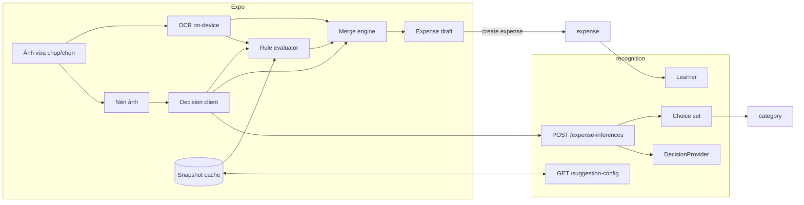

# Technical Design — Gợi ý chi tiêu từ ảnh

| Thông tin  | Giá trị                                                                           |
| ---------- | --------------------------------------------------------------------------------- |
| Phạm vi    | Expo (OCR, nén ảnh, hợp nhất) và server module `recognition` (Decision API, rule) |
| Trạng thái | Đã duyệt; chưa triển khai                                                         |
| Cập nhật   | 2026-10-31                                                                        |
| Issue      | [DEV-48](https://linear.app/devtvn/issue/DEV-48)                                  |

## 1. Tổng quan

### Bối cảnh

Người dùng phải tự nhập số tiền sau khi chụp ảnh ([luồng lưu khoản chi](./01-backend.md)). Server hiện có `recognition-jobs`: job nền quét mỗi 5 giây, gọi Google AI Studio trích xuất hóa đơn, có quota guard in-process ([service](../../apps/server/src/modules/recognition/service.ts)). Kết quả thường đến sau khi người dùng đã nhập xong, không cá nhân hóa và không xử lý được ảnh không in giá (vé gửi xe, đồ ăn). Chưa client nào gọi `recognition-jobs`.

### Mục tiêu và phạm vi

Prefill hoặc gợi ý `amountMinor`, `occurredAt`, `merchant`, `categoryId` từ ảnh, mỗi giá trị có nguồn rõ ràng. Gợi ý luôn tùy chọn: nhập tay và lưu không phụ thuộc OCR, model hay rule ([FR-04, BR-06](../business-requirements.md)).

Phạm vi: Expo và server; thay thế hoàn toàn `recognition-jobs`. Native iOS/Android dùng lại contract khi được ưu tiên. Ngoài phạm vi: trích xuất từng món, nhiều ảnh, thay đổi contract upload media.

## 2. Thiết kế

### Kiến trúc



| Thành phần     | Trách nhiệm                                                                                                                            |
| -------------- | -------------------------------------------------------------------------------------------------------------------------------------- |
| OCR (Expo)     | Local Expo module `modules/billet-ocr` bọc Apple Vision và ML Kit Text Recognition v2; parser TS tìm tổng tiền VND, ngày, tên cửa hàng |
| Nén ảnh (Expo) | `expo-image-manipulator`: bản JPEG nhỏ chỉ dùng cho Decision                                                                           |
| Merge engine   | Hàm thuần `merge(draft, candidates)`: áp thứ tự ưu tiên, khóa autofill, sinh provenance                                                |
| Rule evaluator | Đánh giá rule từ snapshot theo choice, `imageType`, `placeKey`, `merchantKey`                                                          |
| Decision API   | Dựng choice set, gọi một provider trong deadline, validate, ghi `expense_inferences`; không lưu ảnh                                    |
| Learner        | Học choice cá nhân và rule từ expense đã lưu                                                                                           |

`recognition` đọc danh mục qua public service của `category`; `expense` gọi learner qua public boundary của `recognition` với dữ liệu đã chuẩn hóa.

### Luồng xử lý

1. **Có ảnh** (camera/picker trả file): client tạo `generation` mới và chạy song song, không chờ nhau và không chặn preview:
   - OCR trên file gốc (chữ nhỏ cần độ phân giải) → candidate `ocr`.
   - Nén ảnh → `POST /expense-inferences` → loại ảnh, danh mục, choice cá nhân.
   - Nếu người dùng đã cấp quyền và bật dùng vị trí: tính `placeKey` gửi kèm. Không xin quyền chỉ để gợi ý.
2. **Retake/hủy:** hủy request (`AbortController`), bỏ kết quả của generation cũ. Server hủy lời gọi provider khi client ngắt kết nối.
3. **Use photo:** form mở, focus amount; candidate đã có được áp ngay, candidate đến sau tiếp tục merge. Upload media để lưu đi theo contract hiện hành, độc lập với Decision.
4. **Rule:** chạy lại mỗi khi choice, `imageType`, `merchantKey` hoặc `placeKey` thay đổi. Snapshot tải lúc mở app (ETag) nên không thêm round trip.
5. **Lưu:** create expense gửi `inferenceId`, đặc trưng học và `fieldProvenance`; learner chạy sau commit.
6. **Kết thúc lượt:** save, hủy, logout hoặc quá 8 giây kể từ khi có ảnh. Kết quả đến sau bị bỏ; không PATCH expense đã lưu.

Mọi lỗi (không có OCR, nén lỗi, mất mạng, provider lỗi/timeout/bị tắt) đều dẫn tới “không có gợi ý từ nhánh đó”; các nhánh còn lại và nhập tay vẫn chạy. Không retry trong lượt.

### Nén ảnh

Resize cạnh dài tối đa 1024 px, JPEG chất lượng 0,6, re-encode loại EXIF (kể cả GPS). Mục tiêu ~150 KB; nếu > 400 KB encode lại ở 0,45, vẫn vượt thì bỏ Decision. Tham số đến từ snapshot (`decisionImage`) để chỉnh theo benchmark không cần phát hành app. Server không resize, từ chối > 1 MB hoặc không phải JPEG.

### Choice set

Decision Model chỉ chọn trong danh sách server dựng cho từng request; client không gửi choices.

| Nhóm         | Nguồn                                                           | Cấu hình                                |
| ------------ | --------------------------------------------------------------- | --------------------------------------- |
| `image_type` | `decision_choices` toàn hệ thống, seed bằng migration           | Đội phát triển, qua migration           |
| `category`   | Danh mục hệ thống và cá nhân của người dùng (module `category`) | Người dùng, qua tính năng danh mục      |
| `personal`   | `decision_choices` của người dùng, ví dụ “Gửi xe – Tòa A”       | Learner tạo; người dùng sửa/tắt/xóa/tạo |

- Loại ảnh: `receipt`, `invoice`, `parking_ticket`, `transport_ticket`, `payment_screenshot`, `food`, `product`, `other`. Mỗi choice có `label` và `description` mô tả dấu hiệu nhận biết bằng hình ảnh.
- Tối đa 20 choice cá nhân mỗi request, ưu tiên cùng `placeKey` rồi theo lần chọn gần nhất. Choice set cache theo user, có `choiceSetVersion` (hash) lưu vào inference.
- Provider được trả “không chọn” cho `category` và `personal`; lựa chọn ngoài set là output không hợp lệ.
- Choice cá nhân không mang số tiền; nó kích hoạt rule có điều kiện `choiceId`.

### Hợp nhất

| Trường        | Ưu tiên (cao → thấp)                                         |
| ------------- | ------------------------------------------------------------ |
| `amountMinor` | `user` > `ocr` > `personal_rule` > `default_rule`            |
| `occurredAt`  | `user` > `ocr` > thời điểm chụp                              |
| `merchant`    | `user` > `ocr` > `personal_rule`                             |
| `categoryId`  | `user` > `personal_rule` > `decision_model` > `default_rule` |

- Candidate chỉ prefill khi vượt ngưỡng (khởi đầu: OCR amount 0,8; rule cá nhân 0,7; Decision category 0,6; cấu hình qua snapshot), dưới ngưỡng là gợi ý.
- Người dùng bắt đầu sửa/xóa/chọn bất kỳ trường nào → draft `locked`; candidate đến sau chỉ là gợi ý phải chạm để áp dụng. Chỉ focus không khóa.
- Khi chưa khóa, nguồn cao hơn đến muộn thay giá trị của nguồn thấp hơn; nguồn ngang/thấp hơn không thay.
- OCR date chỉ prefill khi không ở tương lai và trong 30 ngày trước thời điểm chụp.
- `merge` idempotent theo `(generation, candidateId)`.
- UI ghi nguồn cạnh giá trị máy điền: “Từ hóa đơn”, “Như lần trước: Gửi xe – Tòa A”, “Gợi ý mặc định”.

### Rule và học

Rule khai báo dạng dữ liệu: điều kiện AND (ít nhất một trong `choiceId`, `imageType`, `placeKey`, `merchantKey`) và hành động (`amountMinor` + `currency`, `categoryId`, `merchant`). Nguồn gốc `default` (chỉ danh mục, không số tiền), `learned` hoặc `user`. Rule nhiều điều kiện khớp hơn thắng; hòa thì `user` > `learned`, rồi `confidence`, rồi mới hơn.

Learner chạy best-effort sau mỗi lần tạo/sửa expense; lỗi không ảnh hưởng save, lần lưu sau tính lại từ dữ liệu nguồn:

1. Khóa học: `personalChoiceId`, `imageType+placeKey`, `merchantKey`, `imageType+merchantKey`.
2. Mỗi khóa đọc tối đa 10 expense còn hiệu lực trong 180 ngày, cùng tiền tệ; trọng số giảm nửa mỗi 60 ngày.
3. Khóa `imageType+placeKey`/`imageType+merchantKey` có ≥ 3 expense mà chưa có choice → tạo choice cá nhân `learned`.
4. Một số tiền chiếm ≥ 60% tổng trọng số với ≥ 3 expense → tạo/cập nhật rule, `confidence` = tỷ trọng; không đạt thì hạ hoặc tắt rule `learned`. Expense bị sửa khác đề xuất tự là bằng chứng phủ định.
5. Không sửa mục `user`; người dùng sửa mục `learned` thì nó thành `user`; xóa mục `learned` chặn học lại khóa đó 90 ngày. Tối đa 100 choice và 500 rule mỗi người dùng, vượt thì bỏ mục `learned` ít dùng nhất.

Ví dụ: chụp vé gửi xe → Decision chọn `parking_ticket` (0,93) và “Gửi xe – Tòa A” (0,85); OCR không có tổng tiền; rule `choiceId = Gửi xe – Tòa A` (4/5 lần 5.000 VND, `confidence` 0,8) prefill 5.000 VND, danh mục Di chuyển.

Settings “Gợi ý tự động”: bật/tắt gợi ý (tắt thì không gửi ảnh), học từ lịch sử, dùng vị trí; quản lý choice cá nhân và rule.

## 3. Contract và dữ liệu

### API

Dưới `/api/v1`, xác thực hiện có; OpenAPI là nguồn chuẩn khi triển khai.

| Endpoint                              | Contract                                                                                                                                                                                                                                                                                                                                                                                                                                    |
| ------------------------------------- | ------------------------------------------------------------------------------------------------------------------------------------------------------------------------------------------------------------------------------------------------------------------------------------------------------------------------------------------------------------------------------------------------------------------------------------------- |
| `POST /expense-inferences`            | Multipart: `image` (JPEG ≤ 1 MB), `clientRequestId`, `timezone`, `locale`, `placeKey?`; header `X-Billet-Deadline-Ms?`. `200`: `id`, `status` (`succeeded`/`unavailable`/`disabled`), `reason?`, `choiceSetVersion`, `imageType`, `category`, `personalChoice` (mỗi mục `{ id, confidence }` hoặc null), `provider`, `model`, `latencyMs`. `400`/`413`/`415` cho input sai. Lỗi provider không trả `5xx`. Idempotent theo `clientRequestId` |
| `GET /suggestion-config`              | Snapshot: loại ảnh, choice cá nhân và rule đang bật, rule mặc định, ngưỡng, `decisionImage`, cờ `features`; hỗ trợ ETag                                                                                                                                                                                                                                                                                                                     |
| `/decision-choices`, `/expense-rules` | `POST`, `PATCH /:id` (theo `version`), `DELETE /:id` cho mục của người dùng; mục hệ thống chỉ đọc                                                                                                                                                                                                                                                                                                                                           |
| `PATCH /profile/settings`             | Thêm `suggestionsEnabled`, `ruleLearningEnabled`, `suggestionLocationEnabled`                                                                                                                                                                                                                                                                                                                                                               |
| Create/update expense                 | Thêm `inferenceId`, `imageType`, `personalChoiceId`, `placeKey`, `merchantKey`, `fieldProvenance` (trường → `{ source, ruleId?, choiceId?, confidence?, outcome }`). Bỏ `recognitionJobId`. `fieldSources` được suy ra từ `fieldProvenance`                                                                                                                                                                                                 |

### Provider interface

```ts
export interface DecisionProvider {
  readonly id: string // 'span-02' | 'd1-ultra' | 'jev' | 'decider' | 'gpt-luna-decision' | 'google-ai-studio' | 'openai-compatible' | ...
  readonly model: string
  readonly limits: { maxImageBytes: number; maxChoices: number }
  decide(input: DecisionInput, signal: AbortSignal): Promise<DecisionOutput>
}

export interface DecisionChoice {
  ref: string // mã ngắn trong phạm vi request: 't3', 'c12', 'p4'
  label: string
  description?: string
}

export interface DecisionInput {
  image: { bytes: Uint8Array; mimeType: 'image/jpeg' }
  choices: {
    imageTypes: readonly DecisionChoice[]
    categories: readonly DecisionChoice[]
    personal: readonly DecisionChoice[]
  }
  locale: string
}

export interface DecisionOutput {
  imageType: { ref: string; confidence: number }
  category: { ref: string; confidence: number } | null
  personal: { ref: string; confidence: number } | null
  usage?: { inputTokens?: number; outputTokens?: number; costMicroUsd?: number }
}
```

Service ánh xạ ID sang `ref` ngắn (giảm token, không lộ ID database) và validate output; sai thì `unavailable: invalid_output`. Adapter chỉ chuyển đổi request/response và phải tôn trọng `AbortSignal`. `google-ai-studio` được viết lại thành Decision adapter, giữ key pool. `fake` và `disabled` cho test và tắt tính năng.

### Dữ liệu

| Bảng                 | Nội dung chính                                                                                                                                                                                    |
| -------------------- | ------------------------------------------------------------------------------------------------------------------------------------------------------------------------------------------------- |
| `decision_choices`   | `userId` (null cho `image_type`), `kind`, `key`, `label`, `description`, `imageTypeKey`, `placeKey`, `merchantKey`, `origin`, `status`, `support`, `lastSelectedAt`, `suppressedUntil`, `version` |
| `expense_rules`      | `userId` (null cho `default`), `origin`, `status`, `conditions`, `actions`, `currency`, `confidence`, `support`, `lastUsedAt`, `suppressedUntil`, `version`; unique `(userId, conditionsHash)`    |
| `expense_inferences` | `userId`, `clientRequestId` (unique theo user), `provider`, `model`, `status`, `reason`, `choiceSetVersion`, lựa chọn, `imageBytes`, `latencyMs`, `usage`; không lưu ảnh; giữ 90 ngày             |
| `expenses` (cột mới) | `inferenceId`, `imageType`, `personalChoiceId`, `placeKey`, `merchantKey`, `fieldProvenance`; index theo `(userId, …)` cho ba khóa học                                                            |

`placeKey` là geohash 7 ký tự (~150 m) tính trên thiết bị; `merchantKey` là tên cửa hàng bỏ dấu, viết thường. Server không lưu ảnh nén, văn bản OCR hay raw output provider. Xóa tài khoản xóa choice, rule và inference của người dùng.

Migration bỏ `recognition-jobs`: drop FK và cột `expenses.recognition_job_id`, drop bảng `recognition_jobs`; giữ type `job_status_enum` vì `export_jobs` còn dùng, chuyển TS enum `JobStatus` sang module `export`. Giá trị `expenses.source = 'recognition'` cũ giữ nguyên; expense mới có `inferenceId` dùng giá trị này.

## 4. Vận hành

Ngân sách từ lúc có ảnh tới khi có kết quả Decision (mục tiêu: thường < 5 s, P95 ≤ 8 s; cần đo trên thiết bị):

| Bước                        | P50    | P95      |
| --------------------------- | ------ | -------- |
| Nén ảnh                     | 0,15 s | 0,4 s    |
| Gửi ~150 KB                 | 0,4 s  | 1,2 s    |
| Dựng choice set (cache)     | 0,05 s | 0,15 s   |
| Provider (timeout cứng 5 s) | 2,0 s  | 4,5 s    |
| Response, overhead          | 0,2 s  | 0,5 s    |
| **Tổng**                    | 2,8 s  | ≤ 6,75 s |

OCR (P95 ~1,5 s) chạy song song, ngoài đường găng. Client gửi ngân sách còn lại qua `X-Billet-Deadline-Ms`; server dùng `min(deadline, EXPENSE_DECISION_TIMEOUT_MS)` và không gọi provider nếu còn dưới 1 giây. Không giữ transaction DB khi chờ provider.

- **Quota:** bỏ quota guard (không chặn, không trì hoãn request). Giữ quota tracking: mỗi inference ghi `usage`; server xuất metric request/token theo provider theo phút và ngày để theo dõi chi phí và giới hạn nhà cung cấp. Provider trả 429 → `unavailable: provider_rate_limited`.
- **Riêng tư:** ảnh rời thiết bị trước Use photo, nên chỉ bật provider có điều khoản không lưu/không huấn luyện (NFR-07) và tôn trọng `suggestionsEnabled`. Không log ảnh, văn bản OCR, số tiền, `placeKey`, nhãn choice. Snapshot cache cô lập theo user, xóa khi logout.
- **Observability:** latency P50/P95 theo provider/model, tỷ lệ `unavailable` theo `reason`, kích thước ảnh; client gửi metadata nguồn và `outcome` từng trường để đo tỷ lệ chấp nhận/sửa.
- **Cấu hình:** `EXPENSE_DECISION_PROVIDER` (mặc định `disabled`), `EXPENSE_DECISION_MODEL`, `EXPENSE_DECISION_BASE_URL`, `EXPENSE_DECISION_API_KEY`, `EXPENSE_DECISION_GOOGLE_API_KEYS`, `EXPENSE_DECISION_TIMEOUT_MS` (5000), `EXPENSE_DECISION_MAX_IMAGE_BYTES` (1 MB). Bỏ toàn bộ `EXPENSE_RECOGNITION_*`.

## 5. Quyết định kỹ thuật

| Quyết định                                       | Lý do và giới hạn chấp nhận                                                                                                                      |
| ------------------------------------------------ | ------------------------------------------------------------------------------------------------------------------------------------------------ |
| Thay `recognition-jobs` bằng Decision đồng bộ    | Gợi ý chỉ có giá trị trong vài giây đầu; job poll không đạt P95. Chưa client nào dùng job nên gỡ ngay, không cần giai đoạn song song             |
| Bỏ quota guard, giữ tracking                     | Guard in-process chỉ đúng với một instance và biến lỗi quota thành chờ đợi; với request đồng bộ, fail nhanh tốt hơn                              |
| Expo dùng development build                      | OCR cần native module. Thêm `expo-dev-client`, dùng prebuild (không commit `ios/`, `android/`); Expo Go và web không có OCR, nhánh OCR tự bỏ qua |
| OCR và Decision bắt đầu ngay khi có ảnh          | Kết quả thường sẵn khi form mở. Ảnh rời thiết bị trước Use photo; Retake tốn thêm request                                                        |
| Ảnh nén gửi inline, không dùng media đã upload   | Bỏ reserve + upload khỏi đường găng, không tạo media cho ảnh bị bỏ. Ảnh truyền hai lần khi lưu                                                   |
| Server sở hữu choice set                         | Output kiểm soát và validate được, gắn với danh mục/choice thật của người dùng                                                                   |
| Model chỉ phân loại, rule mang số tiền           | Vai trò rõ ràng: OCR đọc, model phân loại, rule cá nhân điền giá trị không in trên ảnh                                                           |
| Hợp nhất trên client                             | Client giữ trạng thái chỉnh sửa và kết quả OCR; văn bản OCR không cần lên server                                                                 |
| Học từ expense đã lưu                            | Một nguồn sự thật; sửa/xóa expense tự phản ánh vào rule, không cần event store                                                                   |
| Một provider mỗi request, so sánh bằng benchmark | Latency dự đoán được; hoán đổi provider bằng cấu hình                                                                                            |

## 6. Kiểm chứng và triển khai

### Kiểm chứng

Dự kiến, chưa chạy:

- **Unit Expo:** `merge` (thứ tự ưu tiên, nâng cấp nguồn, khóa sau khi sửa, generation cũ, ví dụ vé gửi xe); parser với fixture hóa đơn tiếng Việt (`58.000`, `58,000đ`, `TỔNG CỘNG`, `dd/MM/yyyy`); rule evaluator; encoder.
- **Unit server:** choice set builder, ánh xạ `ref`, learner (ngưỡng, decay, mục `user`, chặn học lại), idempotency.
- **Integration server:** fake provider chậm 10 s trả `unavailable: timeout` trong deadline; client ngắt kết nối hủy provider; output ngoài set; ảnh quá lớn/sai định dạng; truy cập chéo hai tài khoản; migration gỡ `recognition-jobs` trên dữ liệu có sẵn và export vẫn chạy.
- **Benchmark:** `pnpm --dir apps/server bench:decision --provider <id> --dataset <dir>` trên tập ảnh có nhãn ngoài repo, nén cùng tham số client: accuracy/macro-F1 loại ảnh và danh mục, độ chính xác choice cá nhân, calibration, latency P50/P95, chi phí/ảnh.
- **Thiết bị:** dev build trên iPhone và Android tầm trung, 4G: P50 < 5 s, P95 ≤ 8 s; kết quả đến sau khi sửa không thay giá trị; provider lỗi vẫn lưu nhập tay.

### Triển khai

1. Server: gỡ `recognition-jobs` (controller, worker, entity, quota guard, `recognitionJobId`, config), migration, cập nhật server README và `.env.example`; native/Expo models bỏ `recognitionJobId` (đều là trường optional nên client cũ không lỗi).
2. Server: provider interface, adapter, benchmark CLI; chọn provider mặc định.
3. Server: bảng mới, Decision API, `suggestion-config`, CRUD, provenance, learner; mặc định `EXPENSE_DECISION_PROVIDER=disabled`.
4. Expo: chuyển sang dev build, OCR module, encoder, parser, merge, snapshot, UI nguồn gợi ý và Settings; bật theo cờ `features`.
5. Pilot nội bộ, theo dõi latency và tỷ lệ chấp nhận.

Rollback: provider `disabled` → còn OCR và rule; tắt `features` → nhập tay như hiện tại. Không drop bảng mới khi rollback.

## 7. Tham chiếu

- [Yêu cầu nghiệp vụ](../business-requirements.md): FR-02, FR-04, BR-05, BR-06, NFR-03, NFR-07.
- [Backend](./01-backend.md).
- Source: [recognition service](../../apps/server/src/modules/recognition/service.ts), [quota guard](../../apps/server/src/modules/recognition/providers/quota.guard.ts), [category service](../../apps/server/src/modules/category/service.ts), [expense DTO](../../apps/server/src/modules/expense/dto.ts), [export job entity](../../apps/server/src/modules/export/entities/export-job.entity.ts), [Expo quick capture](../../apps/expo/features/expense/screens/quick-capture-screen.tsx).
