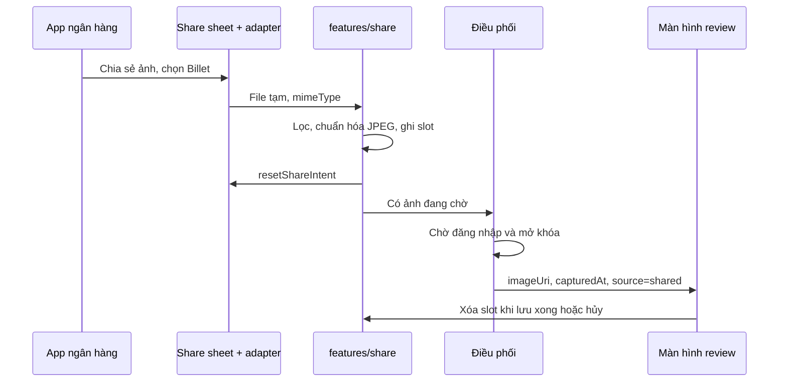

# Technical Design — Nhận ảnh chia sẻ từ app khác

| Thông tin  | Giá trị                                                           |
| ---------- | ----------------------------------------------------------------- |
| Phạm vi    | `apps/expo` trên iOS và Android (development/release build)       |
| Trạng thái | Đã triển khai local; chờ kiểm chứng trên thiết bị thật            |
| Cập nhật   | 2026-11-04                                                        |
| Issue      | [DEV-58](https://linear.app/devtvn/issue/DEV-58)                  |
| Kế hoạch   | [Implementation Plan](../implementation-plans/05-share-intake.md) |

## 1. Tổng quan

### Bối cảnh

Sau khi chuyển tiền, người dùng đang có sẵn biên lai trong app ngân hàng. Share target trong [`app.json`](../../apps/expo/app.json) cho phép chuyển một ảnh vào Billet mà không cần lưu rồi chọn lại từ thư viện.

Phần còn lại của luồng đã có sẵn: màn hình review nhận `imageUri` và `capturedAt` ([`capture-review-screen.tsx`](../../apps/expo/features/expense/screens/capture-review-screen.tsx)), `usePreparePhotoSuggestion` chạy OCR/Decision, và catalog hệ thống đã có loại ảnh chụp màn hình app ngân hàng ([migration](../../apps/server/src/database/migrations/1793305600000-add-expense-suggestions.ts)).

### Mục tiêu và phạm vi

Người dùng bấm chia sẻ trong app khác, chọn Billet và tới màn hình review với ảnh đã nạp, gợi ý chạy như một ảnh chụp thường ([FR-19](../business-requirements.md)). Không có khoản chi nào được tạo cho tới khi người dùng bấm lưu.

Trong phạm vi: đúng một ảnh mỗi lần chia sẻ (FR-05), trên iOS và Android qua Expo.

Ngoài phạm vi:

- Native `apps/ios`, `apps/android` và web. Expo Go không nhận chia sẻ vì thiếu native module.
- Văn bản, PDF, URL và nhiều ảnh. App nguồn chỉ chia sẻ các dạng này thì Billet không xuất hiện hoặc báo chưa hỗ trợ.
- Thay đổi server: dùng nguyên `POST /media`, `POST /expense-inferences`, `POST /expenses`.
- Đồng bộ ngân hàng. Tính năng chỉ nhận ảnh do người dùng chủ động chia sẻ, không đọc dữ liệu từ ngân hàng (BRD mục 4, Ngoài phạm vi ban đầu).

## 2. Thiết kế

### Kiến trúc

| Thành phần  | Vị trí                                      | Trách nhiệm                                                                                                  |
| ----------- | ------------------------------------------- | ------------------------------------------------------------------------------------------------------------ |
| OS adapter  | `expo-share-intent` qua config plugin       | Sinh iOS Share Extension và Android intent filter khi prebuild, chuyển file từ app nguồn sang app            |
| Share inbox | `features/share` (mới)                      | Lọc payload, chuẩn hóa thành JPEG, lưu một slot bền trên đĩa, TTL và dọn dẹp. Không biết route hay khoản chi |
| Điều phối   | `features/expense/shared-capture.tsx` (mới) | Chờ phiên và khóa sinh trắc, mở review, xử lý xung đột với bản nháp                                          |
| Review      | `capture-review-screen.tsx`                 | Nhận `source=shared`, đổi đích thoát, xóa slot khi lưu xong hoặc hủy                                         |

Hướng phụ thuộc: `expense` chỉ gọi public API trong `features/share/index.ts`; `share` không phụ thuộc feature khác. `app/_layout.tsx` chỉ gắn provider.

Native module được nạp có điều kiện như [`ocr.ts`](../../apps/expo/features/suggestion/ocr.ts): Expo Go và web bỏ qua toàn bộ intake, để `pnpm --dir apps/expo start:go` và Docker Compose vẫn chạy.

### Luồng xử lý



1. **Nhận:** adapter trao file tạm. Inbox từ chối payload không phải đúng một ảnh và báo `Billet hiện chỉ nhận một ảnh`.
2. **Chuẩn hóa:** dùng `expo-image-manipulator` giải mã, thu cạnh dài về tối đa 3000 px (`longEdgeResize`), mã hóa JPEG chất lượng 0,9, ghi vào `documentDirectory/share-inbox/` kèm manifest `{ id, fileName, receivedAt }`. Giải mã thất bại thì báo lỗi và không tạo slot.
3. **Mở review:** khi có token và app đã mở khóa, điều phối gọi `prepareSuggestion({ imageUri, capturedAt: receivedAt })` rồi `router.push('/review')`, như `openReview` trong [`quick-capture-screen.tsx`](../../apps/expo/features/expense/screens/quick-capture-screen.tsx).
4. **Kết thúc:** lưu thành công hoặc xác nhận bỏ thì xóa slot và về Journal.

Các nhánh:

| Tình huống                   | Hành vi                                                                       |
| ---------------------------- | ----------------------------------------------------------------------------- |
| Chưa đăng nhập               | Giữ slot; sau khi đăng nhập mở review                                         |
| Khóa sinh trắc đang bật      | Chờ mở khóa, ảnh không hiện dưới lớp khóa                                     |
| Đang review, chưa sửa gì     | Thay bằng ảnh mới                                                             |
| Đang review, bản nháp đã sửa | Hỏi `Thay bằng ảnh vừa chia sẻ?`; chọn giữ thì xóa ảnh mới                    |
| Đang lưu                     | Giữ ảnh mới, xử lý sau khi lưu xong                                           |
| App bị kill khi đang review  | Lần mở sau vào lại review với ảnh trong slot; nội dung đã nhập không được giữ |
| Mất mạng                     | Review vẫn mở; lưu báo lỗi như hiện tại và giữ slot để thử lại                |

### Quy tắc và trạng thái

- **Một slot:** chỉ có một ảnh chờ. Ảnh mới thay ảnh cũ và xóa file cũ, trừ khi người dùng chọn giữ bản nháp.
- **Không tự tạo dữ liệu:** intake không gọi API. Ảnh chỉ rời thiết bị qua pipeline gợi ý hiện có và khi lưu.
- **Slot sống đến khi kết thúc:** manifest còn nghĩa là việc chưa xong. `openedId` trong bộ nhớ ngăn mở review lặp trong cùng phiên.
- **Không nhận lại intent cũ:** gọi `resetShareIntent` ngay sau khi ghi slot, và bỏ qua intent trùng với ảnh vừa xử lý. Android có thể giao lại intent khi mở app từ Recents, nên ảnh đã hủy không được quay lại.
- **Thời gian:** `capturedAt = receivedAt`. Thứ tự `occurredAt` giữ nguyên `user > ocr > thời điểm chụp` ([thiết kế 03](./03-photo-expense-suggestion.md)). Biên lai cũ ngoài cửa sổ ngày của OCR sẽ nhận thời điểm chia sẻ, nên người dùng phải thấy và sửa được giá trị này trước khi lưu.
- **Thoát khỏi review:** với `source=shared`, `capture` không có trong stack. Lối `router.dismissTo('/capture')` được thay bằng `router.replace('/capture')` khi đổi ảnh và `router.dismissTo('/')` khi rời đi. Nút `Chụp lại` đổi nhãn thành `Đổi ảnh`.

## 3. Contract và dữ liệu

### API / Event

Không đổi API server. Boundary mới nằm ở public API của `features/share`:

```ts
type SharedImage = { id: string; uri: string; receivedAt: string }

useShareInbox(): { pending: SharedImage | null; error: ShareIntakeError | null }
completeSharedImage(id: string): Promise<void> // xóa file và manifest, idempotent
```

Tham số route `/review` thêm `source?: 'shared'` và `sharedImageId?: string`. Các route khác không đổi.

Cấu hình native trong `app.json`:

- `expo-share-intent`: iOS chỉ bật `NSExtensionActivationSupportsImageWithMaxCount = 1`; Android chỉ lọc `image/*` với `ACTION_SEND`, không khai báo `ACTION_SEND_MULTIPLE`.
- iOS thêm App Group `group.app.billet.mobile` và target `*.share-extension`, cần được bật trên Apple Developer để build lên máy thật.
- Android: `MainActivity` chạy `launchMode=singleTask` để Billet mở trong task của chính nó, không nằm trong task của app ngân hàng.

### Dữ liệu

Không có thay đổi schema. Slot là dữ liệu cục bộ trên thiết bị:

- Lưu trong `documentDirectory` thay vì cache vì OS có thể xóa cache khi app đang chờ.
- File tạm của adapter (App Group trên iOS, cache trên Android) được xóa ngay sau khi chuẩn hóa.
- JPEG chuẩn hóa không mang EXIF, kể cả GPS.

## 4. Vận hành

- **Riêng tư:** biên lai thường có họ tên, số tài khoản và nội dung chuyển khoản. Slot bị xóa khi lưu xong, hủy, quá 24 giờ, hoặc khi token chuyển từ có sang không (đăng xuất, phiên hết hạn). Trạng thái chưa đăng nhập ngay từ đầu không xóa slot. Không log URI, tên file, app nguồn hay nội dung ảnh.
- **Bộ nhớ và thời gian:** phần trong extension chỉ sao chép file, việc giải mã diễn ra trong app chính nên tránh giới hạn bộ nhớ của extension. Mục tiêu chưa đo: từ lúc chọn Billet tới khi thấy ảnh dưới 2 giây trên máy tầm trung.
- **Giới hạn kích thước:** server giữ `MEDIA_MAX_FILE_SIZE_BYTES` (mặc định 15 MB). JPEG 3000 px dự kiến thấp hơn nhiều; nếu vượt, luồng lưu báo lỗi như hiện tại.

## 5. Quyết định kỹ thuật

| Quyết định                                                                            | Lý do                                                                                                                                                                                   | Đánh đổi / phương án khác                                                                                                                |
| ------------------------------------------------------------------------------------- | --------------------------------------------------------------------------------------------------------------------------------------------------------------------------------------- | ---------------------------------------------------------------------------------------------------------------------------------------- |
| Dùng `expo-share-intent` 9.x                                                          | Bản 9.0.0 khai báo peer `expo ^58`, khớp SDK hiện tại, và tránh tự duy trì config plugin tạo target extension                                                                           | Phụ thuộc bên thứ ba ở phần nhạy cảm với bản iOS. Phương án dự phòng là local module như `billet-ocr`, chọn lại nếu giai đoạn 0 thất bại |
| Extension không xử lý nghiệp vụ, không đăng nhập                                      | Refresh token đang xoay vòng, nên extension và app cùng dùng token dễ xung đột; extension còn bị giới hạn bộ nhớ                                                                        | Không soạn được khoản chi ngay trong share sheet, người dùng luôn chuyển sang app                                                        |
| App phải tự xử lý slot khi được kích hoạt, không phụ thuộc việc extension mở được app | Apple coi `UIApplication` là không khả dụng trong extension; đường qua responder chain không được hỗ trợ chính thức, và có báo cáo `extensionContext.open` âm thầm thất bại trên iOS 26 | Có thể phải thêm bước `Mở Billet` trên iOS, làm luồng chậm hơn một thao tác                                                              |
| Chuẩn hóa mọi ảnh thành JPEG                                                          | Server từ chối HEIC vì `detectImage` không nhận dạng được, và từ chối khi nội dung khác `mimeType` khai báo. Re-encode đồng thời bỏ EXIF                                                | PNG chữ sắc có thể mờ nhẹ; dùng chất lượng 0,9 và 3000 px để giữ OCR                                                                     |
| Điều phối nằm trong `expense`, không nằm trong `share`                                | Giữ `share` là primitive thuần, đúng hướng phụ thuộc feature                                                                                                                            | Thêm một lớp nhỏ                                                                                                                         |

## 6. Kiểm chứng và triển khai

### Kiểm chứng

Các kiểm tra tự động và prebuild đã chạy local; các kịch bản nền tảng dưới đây vẫn cần kiểm chứng trên build đã ký ở Simulator/emulator và thiết bị thật.

Kết quả local ngày 2026-11-04:

- `expo-share-intent` 9.0.0 tạo đúng App Group, bundle `app.billet.mobile.share-extension`, rule một ảnh, Android `ACTION_SEND image/*` và `singleTask`; không có `ACTION_SEND_MULTIPLE`.
- Source extension được sinh vẫn tìm `UIApplication` qua responder chain để mở `billet://dataUrl=...`; đây là đường không chính thức nên chưa chốt được iOS 26/27 hoặc App Review nếu chưa thử build đã ký trên thiết bị thật.
- Format, lint, typecheck, 286 test và web export đã qua; Expo Go khởi động với adapter bị tắt.
- Prebuild không có `DEVELOPMENT_TEAM`; App Group trên Apple Developer, build release và các app ngân hàng thật chưa được kiểm chứng.

| Kịch bản                                                 | Kết quả mong đợi                                            |
| -------------------------------------------------------- | ----------------------------------------------------------- |
| Chia sẻ biên lai PNG từ app ngân hàng khi Billet đã đóng | Tới review với ảnh; lưu được; khoản chi có đúng ảnh         |
| Như trên khi Billet đang chạy nền                        | Tới review, không mở màn hình thừa                          |
| Chia sẻ ảnh HEIC từ Photos (iOS)                         | Lưu thành công dưới dạng JPEG, không còn EXIF GPS           |
| Chưa đăng nhập, chia sẻ, rồi đăng nhập                   | Tới review với ảnh đó                                       |
| Khóa sinh trắc bật                                       | Ảnh chỉ hiện sau khi mở khóa                                |
| Đang sửa bản nháp, chia sẻ ảnh khác                      | Có hỏi; chọn giữ thì bản nháp không đổi                     |
| Hủy review rồi mở lại từ Recents (Android)               | Ảnh đã hủy không quay lại                                   |
| Kill app khi đang ở review                               | Mở lại vào review với ảnh                                   |
| Đăng xuất khi đang có slot                               | File và manifest bị xóa                                     |
| Chia sẻ PDF hoặc nhiều ảnh                               | Billet không xuất hiện hoặc báo chưa hỗ trợ; không tạo slot |
| Tắt `Gợi ý tự động`                                      | Ảnh không được gửi tới Decision                             |
| Lưu lỗi mạng rồi thử lại                                 | Chỉ có một khoản chi (FR-06)                                |
| Khởi động trong Expo Go                                  | App chạy bình thường, không crash do thiếu native module    |

Kèm theo: unit test cho model của inbox, TTL và quyết định xung đột; fixture biên lai ngân hàng cho `receipt-parser`, gồm trường hợp số tài khoản không bị nhận nhầm thành số tiền.

### Triển khai

Chỉ phát hành qua build mới vì thêm native target. Rollback bằng cách bỏ plugin và phát hành lại; slot cũ tự hết hạn và không ảnh hưởng dữ liệu server. Trình tự chi tiết ở [kế hoạch](../implementation-plans/05-share-intake.md).

## 7. Vấn đề chưa chốt

| Vấn đề                                                                                              | Đề xuất mặc định                                                                                                                        | Điều kiện chốt                                                                                                  |
| --------------------------------------------------------------------------------------------------- | --------------------------------------------------------------------------------------------------------------------------------------- | --------------------------------------------------------------------------------------------------------------- |
| Trên iOS, `expo-share-intent` mở app bằng cách nào, có đạt App Review và chạy trên iOS 26/27 không? | Nếu không mở được một cách chính thức, extension hiện `Đã nhận ảnh — Mở Billet`                                                         | Giai đoạn 0, trên máy thật; hỏi Apple DTS nếu cần giữ đường không chính thức                                    |
| Các app ngân hàng mục tiêu chia sẻ dạng gì?                                                         | Giả định là ảnh; chưa kiểm chứng                                                                                                        | Giai đoạn 0, thử với các app ngân hàng người dùng hay dùng. Nếu đa số là PDF hoặc link thì phải mở rộng phạm vi |
| Có gửi biên lai ngân hàng tới Decision provider trước khi người dùng lưu không?                     | Giữ pipeline hiện tại, tôn trọng `Gợi ý tự động`; chính sách NFR-07 phải nêu rõ biên lai ngân hàng trước khi thử nghiệm với người ngoài | Chủ sản phẩm quyết định trước giai đoạn 3                                                                       |
| Biên lai chuyển tiền cho người thân có phải là chi tiêu không?                                      | Người dùng tự quyết bằng cách lưu hay hủy; không tự phân loại                                                                           | BRD đang loại chuyển khoản nội bộ khỏi phạm vi ban đầu                                                          |

## 8. Tham chiếu

- [Business Requirements](../business-requirements.md): FR-03, FR-05, FR-06, FR-19, NFR-04, NFR-05, NFR-07.
- [Technical Design — Gợi ý chi tiêu từ ảnh](./03-photo-expense-suggestion.md).
- [`media/service.ts`](../../apps/server/src/modules/media/service.ts): kiểm tra loại ảnh khi upload.
- [expo-share-intent](https://github.com/achorein/expo-share-intent).
- Apple Developer Forums: [responder chain từ Share Extension](https://developer.apple.com/forums/thread/848791), [Share Extension không mở app trên iOS 26](https://developer.apple.com/forums/thread/839811), [openURL trên iOS 18](https://developer.apple.com/forums/thread/764570).
